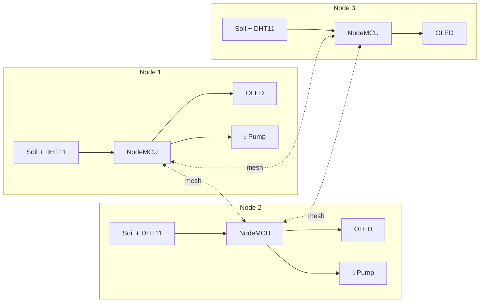

<div align="center">


### 📡 Sensor nodes that talk to each other — and water the field on their own.


</div>

---

## 📌 At a glance

> Many farms have **no reliable internet**. This system builds its **own wireless network**: several NodeMCU sensor nodes form a **self-organising mesh**, share soil and climate readings with each other, show them on a small **OLED screen**, and **switch the water pump on automatically** when the soil gets dry.

<div align="center">
  
  <br/><sub><i>The mesh on the bench — each node with its own sensors and OLED display</i></sub>
</div>

---

## ✨ What it does

<table>
<tr>
<td width="25%" align="center" valign="top">

### 🌐 Builds its own network
Nodes join a **painlessMesh** network automatically — no router, no internet.

</td>
<td width="25%" align="center" valign="top">

### 🌡️ Measures
**Soil moisture**, **temperature** and **humidity** (DHT11) at every node.

</td>
<td width="25%" align="center" valign="top">

### 📢 Shares
Each node **broadcasts its readings as JSON** to the whole mesh.

</td>
<td width="25%" align="center" valign="top">

### 🚿 Acts
If the soil reads **dry**, the node **switches its pump on**; when wet, off.

</td>
</tr>
</table>

---

## 🔄 How it works



Every node is equal: there is no central server that can fail. A node that can't reach another directly passes the message through its neighbours.

---

## 🔌 Circuit

<div align="center">

<br/><sub><b>One node:</b> NodeMCU · DHT11 · soil-moisture sensor · OLED · relay and pump</sub>
</div>

| Part | Pin |
|---|---|
| DHT11 data | GPIO 2 |
| Soil-moisture sensor | A0 |
| Pump relay | GPIO 12 |
| Manual switch | GPIO 13 |
| OLED (SSD1306, I²C) | SDA / SCL, address 0x3C |

---

## 💻 Code

[`Mesh_Networking.ino`](Mesh_Networking.ino):

```cpp
void sendMessage() {
  DynamicJsonDocument doc(1024);
  doc["MOISTURE"]    = analogRead(A0) <= 1000 ? "Wet" : "Dry";
  doc["TEMPERATURE"] = dht.readTemperature();
  doc["HUMIDITY"]    = dht.readHumidity();
  String msg; serializeJson(doc, msg);
  mesh.sendBroadcast(msg);            // every node hears it
}

void loop() {
  if (analogRead(A0) <= 1000) digitalWrite(trigPin, LOW);   // wet → pump off
  else                        digitalWrite(trigPin, HIGH);  // dry → pump on
  mesh.update();
}
```

<details>
<summary><b>▶ How to run it</b></summary>

1. Install **painlessMesh**, **ArduinoJson**, **DHT sensor library** and **Adafruit SSD1306** in the Arduino IDE
2. Set your own `MESH_PREFIX` and `MESH_PASSWORD` — the same on every node
3. Upload the sketch to two or more NodeMCUs
4. Power them up: they find each other and start sharing readings on the Serial Monitor (115200 baud)

</details>

---

## 🧠 What I learned

- 📡 **Mesh networking** — self-healing, router-free communication between microcontrollers
- 🧾 **Structured messages** with JSON on tiny devices
- 🌱 **Closed-loop control** — sensing soil moisture and acting on it automatically

---

<div align="center">

### 👋 Built by **Ajay Arjun Mannolkar**
[](https://technolkar.github.io)
[](https://www.linkedin.com/in/ajaymannolkar)
[](https://www.youtube.com/@TechnolkarInnovations)


</div>
